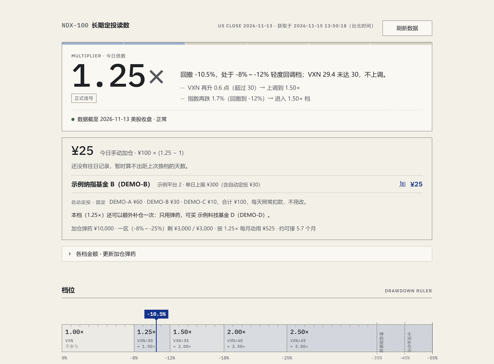

# Nasdaq-100 定投决策仪表盘

> 公开展示版：基金、金额和弹药额度都是示例数值，规则与代码和实际使用的版本一致。

<!-- 截图：把仪表盘首屏截图放到 docs/screenshot.png 后取消下一行的注释 -->
<!--  -->

## 项目简介

一个为长期定投纳斯达克 100 做的决策工具。每个交易日，它把前一晚的美股收盘数据读成一句能直接执行的结论：今天要不要加仓、加多少、为什么；再通过微信推送到手机。

**解决的问题**：长期定投真正难的是在大跌时按规则行事，而不是被情绪带着加满或停掉。这个工具把一套事先定好的规则变成每天的读数，并在数据不可靠时明确拒绝给出结论，避免拿错误的数据做决定。

**规则设计**

- **回撤分档决定基础倍数**（1.0× / 1.25× / 1.5× / 2.0× / 2.5×），VXN 在每一档超过阈值时上调一档，最高 3.0×。
- **数据门槛**：只有 ^NDX 和 VXN 都是新鲜、有效的数据时才给出正式倍数；QQQ 代理、过期、回退或手动输入的数据只作参考，不生成倍数。
- **资金约束**：自动定投金额固定；倍数多出来的部分每天手动加仓，钱来自按回撤分区限额的"弹药"，某个区的额度用完就自动停止加仓，防止在下跌早期把钱用光。
- **参考指标不进决策**：估值（PE 代理）和情绪（CNN Fear & Greed）只做文字提示，不改变倍数。

**技术栈**

- 数据：Yahoo Finance（yfinance）的 ^NDX / QQQ / ^VXN、CNN Fear & Greed、iShares IQQ 组合 P/E；每个数据接口都有超时和降级处理。
- 前端：Streamlit，核心面板用自绘 HTML/CSS（"精密仪器"设计规范，见 `DESIGN.md`），图表用 ECharts，手机优先。
- 存储：Supabase（可选），未配置时回退到本地 CSV / JSON。
- 推送：GitHub Actions + Server酱，按 A 股交易日历每天推送微信消息；同一天不重复发送，数据异常时只发警告。
- 测试：pytest，约 215 个测试，覆盖倍数规则、数据降级、资金分配、推送内容和访问口令。

## 项目用途

这是一个长期定投辅助仪表盘。回撤决定基础定投倍数，VXN 在指定回撤区间确认是否上调一档；PE 用于估值辅助提示。

## 四个核心指标与数据来源

- VXN：Nasdaq-100 波动率指数，Yahoo Finance `^VXN`，使用约 10 年历史 percentile。
- Fear & Greed：CNN 美国股票市场 Fear & Greed，仅作股票情绪参考，不参与仓位决策。
- Nasdaq-100 P/E Proxy：BlackRock/iShares IQQ Portfolio P/E。IQQ 的官方基准为 Nasdaq 100 Index，因此可作为直接跟踪指数的 ETF 估值代理；该数值仍不是 Nasdaq 官方指数 P/E。获取失败时显示暂无可靠估值数据。
- Drawdown：优先使用 Yahoo Finance `^NDX`，失败时使用 `QQQ` 代理；按全部可用历史中的最高收盘价计算。

所有 adapter 都有 timeout/异常降级；失败返回 N/A，不使用随机值或硬编码实时值。

## 页面结构

设计规范见 `DESIGN.md`（精密仪器风格），产品定位见 `PRODUCT.md`。页面自上而下：

1. **今日读数**：倍数、一句话理由、距下一档还差多少、数据新鲜度；PE ≥35 或 ≤22 时给出文字提示（不影响倍数）。
   - **今日加仓**：按倍数算出今天手动加仓多少、买哪只，固定的自动定投金额，距上次换档几天，本档能否额外补仓，弹药所在区和还能撑几个月。金额属于个人信息，配置了访问口令时需先解锁。
2. **档位尺**：回撤游标落在哪一档，每档标注基础倍数与 VXN 上调条件，下方是 VXN 副尺。-35% 以下压缩显示：-35% 起为弹药保留区，-45%、-55% 是手动补仓点（倍数仍最高 3.0×）。
3. **指标**：决策指标（回撤、VXN）与参考指标（Fear & Greed、PE）分组。
4. **走势**：回撤与 VXN 联动图（带档位线），默认 1 年；NDX、FGI、PE 在"更多图表"中。
5. **数据健康**：诊断明细、快照 ID、CSV 导出、存储状态、手动覆盖（应急）。有异常时自动展开。

数据按前一晚美股收盘缓存 1 小时，不自动刷新，可手动刷新。

## 评分与加仓

最终规则为：0～-8% 为 1.0×；-8%～-12% 为 1.25×（VXN >30 时 1.5×）；-12%～-18% 为 1.5×（VXN >35 时 2.0×）；-18%～-25% 为 2.0×（VXN >40 时 2.5×）；≤-25% 为 2.5×（VXN >45 时 3.0×）。

## 自动定投、每日加仓与弹药

以下数字来自仓库里的示例配置 `funds.yaml`，换成自己的配置后会随之改变。

- **自动定投固定**：示例基金 A ¥60、B ¥30、C ¥10，每天 ¥100，不随倍数变化；C 不参与加仓。示例基金 D 只用于"新档位额外补一次"，E 暂停。
- **每日手动加仓** = 自动定投合计 × (倍数 − 1)，四舍五入到整数元（示例：1.25× ¥25、1.5× ¥50、2.0× ¥100、2.5× ¥150、3.0× ¥200），按 `topup_priority` 填进可加仓基金的单日剩余额度（单日上限 − 自动定投）。
- 只有加仓动用弹药：每月动用 = 每日加仓 × 21。示例弹药 ¥10,000 分三个区：-8%～-25% 一区 ¥3,000、-25%～-35% 二区 ¥4,000、-35% 以下保留区 ¥3,000。某区用完后不再加仓（按 1.00×），直到回撤进入下一区；剩余额度不够一天时按剩余额度加。
- **自动记账**：每个交易日推送成功后，当天的加仓金额自动计入当前弹药区的已用额度并从余额扣除（同一天只记一次，试运行不记）。没加仓或金额不同，在页面的弹药表单里改。弹药余额未填写时不记账。
- 每个档位（各倍数档以及 -45%、-55%）可以额外补仓一次，只用弹药，在页面记录，可撤销。
- 页面和推送都显示"距上次换档 X 天"，换档当天写出新旧加仓金额。
- 弹药数据存到 Supabase 的 `nasdaq_dashboard_settings` 表（键 `ammo_state`）；未配置 Supabase 时存到本地 `data/settings.local.json`（不进 git）。

### 上线前需要做的两步

1. 在 Supabase SQL Editor 再执行一次 `supabase_schema.sql`（新增 `nasdaq_dashboard_settings` 表并授权给 `service_role`，已有的表不受影响）。如果页面或推送日志提示 `permission denied for table nasdaq_dashboard_settings`，说明授权语句没有执行。
2. 在 Streamlit Cloud 的 **App settings → Secrets** 里加一行访问口令（自己设定，不要提交到 GitHub）：

```toml
access_code = "你的口令"
```

未设置 `access_code` 时，加仓金额和弹药余额对所有访客可见。

## 每日微信推送（阶段三）

GitHub Actions（`.github/workflows/daily-push.yml`）运行 `python -m push.daily_push`，通过 Server酱推送一条消息到微信。实际使用时在**每个 A 股交易日北京时间 8:30** 定时运行；本展示版没有配置 Secrets，因此去掉了定时触发，只保留手动运行（默认 `dry_run`，只打印不发送）。

- **标题就是结论**，例如（示例配置）`纳指 1.5× · 加仓 DEMO-B ¥50`、`纳指 1.0× · 今日无需加仓`、`换档 1.5→2.0× · 每日加仓¥100`、`纳指 2.0× · 本区弹药用完 今日不加仓`、`⚠ 数据异常 · 请打开仪表盘核对`。
- **正文**包括：
  - 理由，以及距下一档还差多少；
  - 今天手动加仓多少、买哪只（换档时写出原金额），固定的自动定投照常扣款；
  - 距上次换档几天、本档能否额外补仓、回撤接近下一档时提醒；
  - 弹药所在区、剩余额度、每月动用和还能撑几个月，当天加仓已自动记账，以及 PE 提示；
  - 上次推送的日期和倍数，以及仪表盘链接。
- **只在 A 股交易日发**（按 `chinesecalendar` 判断，周末调休的工作日不发）。长假后的第一天会和假期前最后一次推送比较，标出档位变化。
- **数据异常时只提示，不给金额**。推送状态（上次倍数、当天是否已发）存在 Supabase 的 `nasdaq_dashboard_settings` 表里，同一天不会重复推送。
- 决策逻辑与页面一致：只有 ^NDX 和 VXN 都是新鲜的有效数据时，才给出正式倍数。

### 配置步骤

1. 在 [Server酱](https://sct.ftqq.com/) 用微信登录，复制你的 **SendKey**。
2. 在 GitHub 仓库 **Settings → Secrets and variables → Actions** 中：
   - **Secrets**：添加 `SERVERCHAN_SENDKEY`、`SUPABASE_URL`、`SUPABASE_KEY`（与 Streamlit Secrets 中的 Supabase 配置相同）。
   - **Variables**：添加 `DASHBOARD_URL`（仪表盘网址，用于推送里的链接）。
3. 在 **Actions → Daily push → Run workflow** 中手动运行一次。默认勾选 `dry_run`，只在运行日志里打印消息，不发送。确认无误后，取消勾选 `dry_run` 再运行一次，检查微信是否收到推送。
4. 需要每天自动推送时，在 `.github/workflows/daily-push.yml` 的 `on:` 下加回定时触发：`schedule: - cron: "30 0 * * 1-5"`（北京时间周一至周五 8:30）。

本地试运行（不发送、不保存）：

```bash
pip install -r requirements-push.txt
python -m push.daily_push --dry-run --date 2026-11-16
```

GitHub 的定时任务可能会推迟几分钟到半小时启动，但仍远早于 15:00 的下单截止时间。推送失败时工作流会显示失败，GitHub 会发邮件通知。

## 本地运行

```bash
pip install -r requirements.txt
streamlit run app.py
```

## 部署到 Streamlit Community Cloud

1. 创建 GitHub repository。
2. 上传本项目文件。
3. 登录 Streamlit Community Cloud，点击 **New app**。
4. 选择 repository，Branch 选择 `main`。
5. Main file path 填 `app.py`，点击 **Deploy**。
6. 部署后通过类似 `https://xxxx.streamlit.app` 的公网 URL 访问。

## 历史与云端限制

本地快照写入 `data/history.csv`，同日覆盖。Community Cloud 本地文件系统可能在重启、redeploy 或 instance reset 后丢失；如需持久化可配置 Supabase。当前版本主要用于查看当前市场状态，不保证 CSV 永久保存。

## Supabase（可选）

在 Supabase SQL Editor 执行 `supabase_schema.sql`，然后在 Streamlit Cloud 的 **App settings → Secrets** 中填写：

```toml
[supabase]
url = "https://your-project.supabase.co"
key = "your-server-side-key"
```

不要将真实 key 提交到 GitHub；`.streamlit/secrets.toml` 已被 `.gitignore` 忽略。应用会优先使用 Supabase，连接失败时明确显示并回退到本地 CSV。数据健康面板提供手动 CSV migration，迁移不会删除本地文件。

## 局限

PE 是直接跟踪 Nasdaq-100 的 IQQ ETF portfolio proxy。Fear & Greed 是 CNN 美股情绪参考，完全退出仓位决策。数据延迟、来源变化、网络限制和历史样本不足都会降低可信度。请勿使用生活费、应急金或借款加仓。
